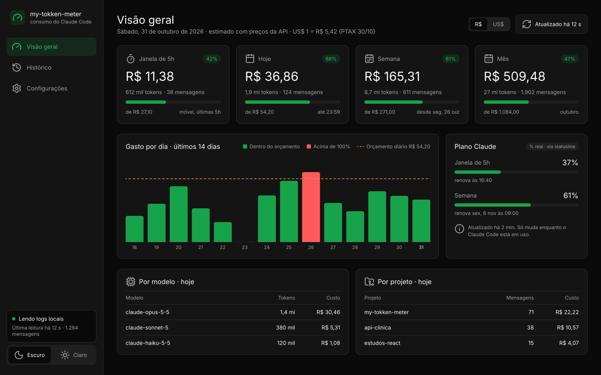

# my-tokken-meter

Medidor **local** do seu consumo do [Claude Code](https://claude.com/claude-code): sessão de 5 horas (com o horário em
que renova), dia, semana e mês, em R$ ou US$ estimado e tokens, com alertas quando você chega a 80% e 100% do
orçamento que definiu.



## O que tem

- **Painel no navegador**, tema claro e escuro: visão geral, histórico (por dia, sessão, projeto e modelo) e
  configurações. Telas em [`docs/design/`](docs/design/README.md).
- **Quando cada período renova**: os cards de 5h, dia, semana e mês mostram "Renova em…", o horário e a % do tempo
  que já passou. A sessão de 5h usa o horário oficial da statusline ou uma estimativa pelos logs.
- **Entrada pela sua conta do Claude**, lida com `claude auth status` (sem ler o token); o login fica salvo em
  `data/conta.json` e o app abre direto no painel até você clicar em **Sair**.
- **R$ ou US$**, com a cotação PTAX do Banco Central (a única chamada de rede do app, uma vez por dia).
- **Alertas aos 80% e 100%** (o 80% segue o limiar que você define): banner, notificação do Windows, aviso dentro
  do Claude Code e statusline, cada um uma vez por período.
- **% real do plano** (5h e semana), lida da statusline do Claude Code, sem usar o seu token.
- **Servidor MCP**: pergunte ao Claude "quanto já usei hoje?".

Nada sai do seu computador: o app lê os logs em `~/.claude/projects` e guarda tudo em `data/` (fora do git).

## Rodar

Requer Node.js 24 ou mais novo.

```bash
npm install
npm run dev        # abre http://127.0.0.1:5178
```

No PowerShell do Windows, se aparecer "npm.ps1 não pode ser carregado", use `npm.cmd run dev` ou rode uma vez
`Set-ExecutionPolicy -Scope CurrentUser RemoteSigned`.

Versão compilada: `npm run build` e depois `npm start`.

## Integrar ao Claude Code (opcional)

```bash
npm run integrar     # mostra o que muda, pede confirmação e faz backup do ~/.claude/settings.json
npm run desintegrar  # remove só o que o integrar instalou
```

Instala o servidor MCP (`consumo_atual`, `consumo_periodo`, `status_orcamento`), o aviso na conversa (hook
`UserPromptSubmit`) e a statusline (`dia 42% · sem 61% · 5h renova 16:40 · plano 5h 37%`). Se você já usa outra
statusline, ela não é substituída.

## Desenvolvimento

| Comando                  | O que faz                                 |
| ------------------------ | ----------------------------------------- |
| `npm test`               | testes (`node:test`, dados fictícios)     |
| `npm run lint`           | ESLint + Prettier                         |
| `npm run build`          | checagem de tipos + build do front        |
| `npm run check:segredos` | barra tokens, e-mails e caminhos pessoais |

Arquitetura e decisões em [`docs/`](docs/ARCHITECTURE.md) e no plano
[`docs/specs/2026-10-31-my-tokken-meter.md`](docs/specs/2026-10-31-my-tokken-meter.md). O custo é **estimado** com os
preços públicos da API (editáveis nas configurações); no plano Pro/Max não é cobrança.

## Licença

[MIT](LICENSE). Ícones: [Lucide](https://lucide.dev) (ISC).
