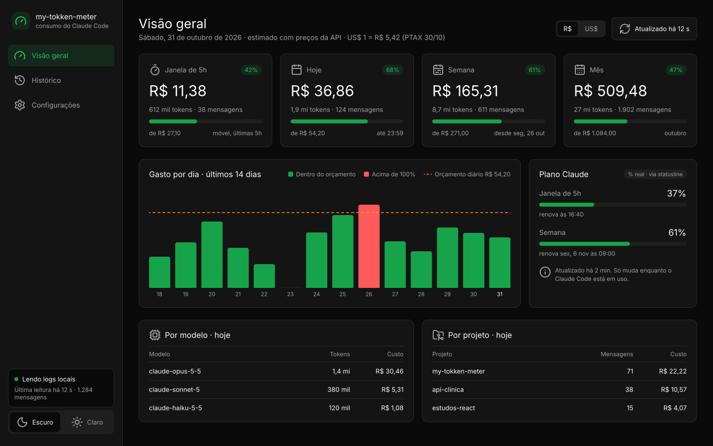
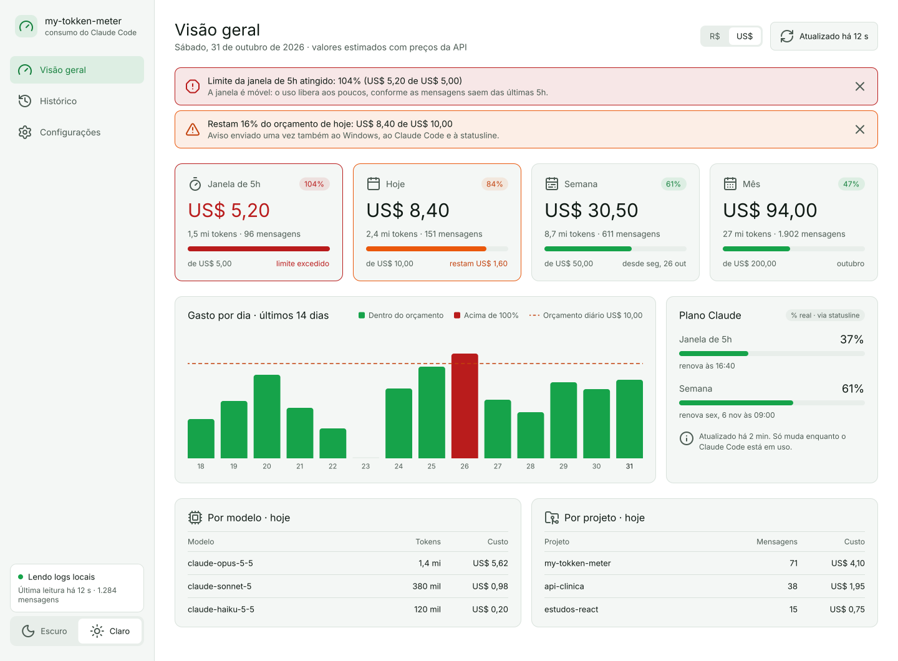

# Telas do my-tokken-meter

Desenhadas no FigCraft (`my-tokken-meter.figcraft`), desktop 1440 px, temas escuro e claro a partir das mesmas
variáveis (coleção **Tema**, modos Escuro e Claro). Ícones Lucide em [`icons/`](icons/). Tokens de cor em
[DESIGN.md](../DESIGN.md).

Dados das telas são **fictícios**.

| #   | Tela                     | Escuro                                           | Claro                                           |
| --- | ------------------------ | ------------------------------------------------ | ----------------------------------------------- |
| 00  | Entrar (conta conectada) | [svg](svg/00-entrar-escuro.svg)                  | [svg](svg/00-entrar-claro.svg)                  |
| 00  | Entrar (sem conta)       | [svg](svg/00-entrar-sem-conta-escuro.svg)        | [svg](svg/00-entrar-sem-conta-claro.svg)        |
| 01  | Dashboard                | [svg](svg/01-dashboard-escuro.svg)               | [svg](svg/01-dashboard-claro.svg)               |
| 02  | Dashboard com alerta     | [svg](svg/02-dashboard-alerta-escuro.svg)        | [svg](svg/02-dashboard-alerta-claro.svg)        |
| 03  | Sem orçamento            | [svg](svg/03-dashboard-sem-orcamento-escuro.svg) | [svg](svg/03-dashboard-sem-orcamento-claro.svg) |
| 04  | Primeiro uso             | [svg](svg/04-primeiro-uso-escuro.svg)            | [svg](svg/04-primeiro-uso-claro.svg)            |
| 05  | Vazio                    | [svg](svg/05-vazio-escuro.svg)                   | [svg](svg/05-vazio-claro.svg)                   |
| 06  | Erro                     | [svg](svg/06-erro-escuro.svg)                    | [svg](svg/06-erro-claro.svg)                    |
| 07  | Histórico                | [svg](svg/07-historico-escuro.svg)               | [svg](svg/07-historico-claro.svg)               |
| 08  | Configurações            | [svg](svg/08-configuracoes-escuro.svg)           | [svg](svg/08-configuracoes-claro.svg)           |

## Regras visuais

- Verde: dentro do orçamento e ações principais. Laranja: 80% (alerta). Vermelho: 100% ou mais e erros.
- Estado nunca só pela cor: sempre há % escrita, ícone (`triangle-alert`, `octagon-alert`) ou texto.
- Moeda: seletor R$ | US$ no cabeçalho; cotação PTAX do Banco Central, automática (o Dashboard 01 mostra R$).
- Conta: lida com `claude auth status` (e-mail e plano), sem ler o token.
- Escuro neutro (preto `#0A0A0A`), contraste AA conferido; claro inalterado.
- Valores em `JetBrains Mono`; textos em `IBM Plex Sans`.

## Prévia

